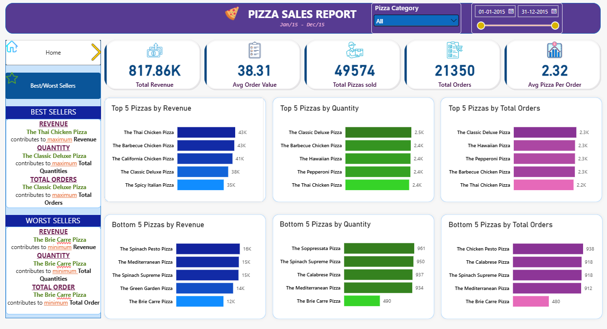

# 🍕 Pizza Sales Analysis – Power BI Dashboard

An interactive two-page Power BI report that analyses a full year of pizza sales (**Jan 2015 – Dec 2015**). It answers three business questions: *what sells, when does it sell, and what doesn't?*

---

## 📌 Table of Contents
- [Project Overview](#-project-overview)
- [Dashboard Pages](#-dashboard-pages)
- [KPIs Tracked](#-kpis-tracked)
- [Key Insights](#-key-insights)
- [Data Model](#-data-model)
- [SQL Analysis](#-sql-analysis)
- [Tools Used](#-tools-used)
- [Repository Structure](#-repository-structure)
- [How to Open the Dashboard](#-how-to-open-the-dashboard)
- [Author](#-author)
- [Dashboard Screenshots](#-dashboard-screenshots)

---

## 🎯 Project Overview

The goal of this project is to turn raw pizza order data into a clear, interactive report that a restaurant owner or operations manager can use to:

- Track overall sales performance through headline KPIs
- Understand which **categories** and **sizes** drive revenue
- Identify the **busiest days and months** to plan staffing and inventory
- Spot the **best and worst performing pizzas** by revenue, quantity and number of orders

---

## 📊 Dashboard Pages

The report contains **two pages** connected by a left-hand navigation panel.

### 1️⃣ Home – Sales Overview
| Visual | What it shows |
|---|---|
| KPI cards | Total Revenue, Total Orders, Total Pizzas Sold, Avg Order Value, Avg Pizzas per Order |
| Daily Trend for Total Orders (column chart) | Orders by day of the week |
| Monthly trend (area chart) | Orders by month |
| % of Sales by Pizza Category (donut) | Revenue share of each category |
| % of Sales by Pizza Size (donut) | Revenue share of each size |
| Total Pizzas Sold by Pizza Category (funnel) | Quantity sold per category |

### 2️⃣ Best / Worst Sellers
Top 5 and Bottom 5 pizzas, each ranked three ways:

| | Best Sellers | Worst Sellers |
|---|---|---|
| **Revenue** | Top 5 Pizzas by Revenue | Bottom 5 Pizzas by Revenue |
| **Quantity** | Top 5 Pizzas by Quantity | Bottom 5 Pizzas by Quantity |
| **Total Orders** | Top 5 Pizzas by Total Orders | Bottom 5 Pizzas by Total Orders |

### 🎛️ Interactivity
- **Date range slicer** (between) – filter both pages to any period
- **Pizza Category slicer** (dropdown) – filter by Classic, Supreme, Chicken or Veggie
- **Page navigator** – switch between Home and Best/Worst Sellers
- Cross-filtering between all visuals on a page

---

## 📏 KPIs Tracked

| KPI | Meaning | Value (Jan–Dec 2015) |
|---|---|---|
| **Total Revenue** | Sum of all sales value | **817.86K** |
| **Total Orders** | Number of distinct orders | **21,350** |
| **Total Pizzas Sold** | Sum of quantity sold | **49,574** |
| **Avg Order Value** | Total Revenue ÷ Total Orders | **38.31** |
| **Avg Pizzas per Order** | Total Pizzas Sold ÷ Total Orders | **2.32** |

---

## 💡 Key Insights

- **Category:** The **Classic** category contributes the most to sales (26.91%) and sells the most pizzas (~15K), followed by Supreme (25.46%), Chicken (23.96%) and Veggie (23.68%).
- **Size:** **Large** pizzas generate the highest share of sales (45.89%), followed by Medium (30.49%) and Regular (21.77%). X-Large and XX-Large together contribute under 3%.
- **Busiest days:** **Friday** has the most orders (~3.5K), followed by Thursday and Saturday (~3.2K each). Sunday is the quietest day (~2.6K).
- **Seasonality:** **July** is the peak month (1,935 orders). May (1,853) and January (1,845) follow. The slowest months are **October** (1,646) and **September** (1,661).
- **Best sellers:** **The Thai Chicken Pizza** brings in the most revenue, while **The Classic Deluxe Pizza** leads in both total quantity and total orders.
- **Worst seller:** **The Brie Carre Pizza** ranks lowest on revenue, quantity and total orders — a candidate for menu review.

---

## 🗂️ Data Model

- **Database:** PostgreSQL, single flat table `public.pizza_sales`, loaded into Power BI
- **Dimensions used in the report:** `order_date`, `pizza_category`, `pizza_name`, `pizza_size`
- **Calculated fields:** `Order Day`, `Order Month`
- **Measures:** Total Revenue, Total Orders, Total Pizzas Sold, Avg Order Value, Avg Pizza Per Order

### `pizza_sales` table schema

| Column | Type | Notes |
|---|---|---|
| `pizza_id` | INTEGER | Primary key (one row per pizza line item) |
| `order_id` | INTEGER | An order can contain several pizzas |
| `pizza_name_id` | VARCHAR(50) | Pizza code |
| `quantity` | INTEGER | Pizzas on the line item |
| `order_date` | DATE | |
| `order_time` | TIME | |
| `unit_price` | NUMERIC(6,2) | |
| `total_price` | NUMERIC(8,2) | `unit_price × quantity` |
| `pizza_size` | VARCHAR(5) | Regular, Medium, Large, X-Large, XX-Large |
| `pizza_category` | VARCHAR(20) | Classic, Supreme, Chicken, Veggie |
| `pizza_ingredients` | TEXT | |
| `pizza_name` | VARCHAR(100) | |

## 🧮 SQL Analysis

All KPIs were first calculated in PostgreSQL (`sql/PIZZA_sales_sql_new.sql`) and then rebuilt as measures in Power BI, so the dashboard numbers can be cross-checked against the queries.

| # | Business question | Technique |
|---|---|---|
| Q1 | Total Revenue | `SUM(total_price)` |
| Q2 | Average Order Value | `SUM(total_price) / COUNT(DISTINCT order_id)` |
| Q3 | Total Pizzas Sold | `SUM(quantity)` |
| Q4 | Total Orders | `COUNT(DISTINCT order_id)` |
| Q5 | Average Pizzas per Order | Ratio with `CAST ... AS DECIMAL(10,2)` to avoid integer division |
| Q6 | Orders by day of week | `TO_CHAR(order_date, 'Day')` + `GROUP BY` |
| Q7 | Orders by month | `TO_CHAR(order_date, 'Month')`, sorted descending |
| Q8 | % of sales by pizza category (January) | Percentage of total using a scalar subquery + `EXTRACT(MONTH ...)` |
| Q9 | % of sales by pizza size (January) | Same technique, grouped by size |
| Q10 | Top 5 pizzas by revenue | `GROUP BY` + `ORDER BY ... DESC LIMIT 5` |
| Q11 | Top 5 pizzas by total orders | `COUNT(DISTINCT order_id)` + `LIMIT 5` |

**SQL concepts used:** aggregate functions, `COUNT(DISTINCT)`, `GROUP BY`, `ORDER BY`, `LIMIT`, subqueries, `CAST`, date functions (`TO_CHAR`, `EXTRACT`), percentage-of-total calculations.

---

## 🛠️ Tools Used

| Tool | Purpose |
|---|---|
| **PostgreSQL** (pgAdmin 4) | Database for the `pizza_sales` table; all KPI and analysis queries were written and run here |
| **SQL** | Aggregations, `GROUP BY`, subqueries, `CAST`, date functions (`TO_CHAR`, `EXTRACT`) |
| **Microsoft Excel** | Raw dataset and data inspection |
| **Power BI Desktop** | Data modelling, DAX measures and the two-page interactive dashboard |
| **DAX** | Measures for revenue, orders, pizzas sold, average order value and pizzas per order |
| **Microsoft Word** | Documentation of the SQL queries and their outputs |
| **GitHub** | Version control and project hosting |

---|---|
| **SQL** | Data querying and KPI validation |
| **Microsoft Excel** | Data inspection and cross-checking |
| **Power BI Desktop** | Data modelling (DAX) and dashboard design |
| **Microsoft Word** | Project documentation / report |

---

## 📁 Repository Structure

```
pizza-sales-analysis/
│
├── dashboard/
│   └── pizza_sales_power_bi_final.pbix     # Power BI report (2 pages)
│
├── sql/
│   └── PIZZA_sales_sql_new.sql             # Table definition + KPI queries (Q1–Q11)
│
├── data/
│   └── <your Excel file>.xlsx              # Dataset / supporting workbook
│
├── docs/
│   └── Word-_pizza_sales.docx              # SQL queries with outputs (documentation)
│
├── images/
│   ├── home_dashboard.png
│   └── best_worst_sellers.png
│
└── README.md
```

---

## ▶️ How to Open the Dashboard

1. Clone or download this repository
2. Install **[Power BI Desktop](https://powerbi.microsoft.com/desktop/)** (free, Windows)
3. Open **(https://github.com/Aratrikabasu2026/pizza-sales-analysis-powerbi-sql/blob/main/power%20bi%20pizza%20sales%20template.pbit)**


---

## 👤 Author

**Aratrika Basu**
- LinkedIn: 
- GitHub: [@<Aratrikabasu2026>](https://github.com/<Aratrikabasu2026>)

⭐ If you found this project useful, consider giving it a star!

---

## 🖼️ Dashboard Screenshots

### Page 1 – Home


### Page 2 – Best / Worst Sellers

